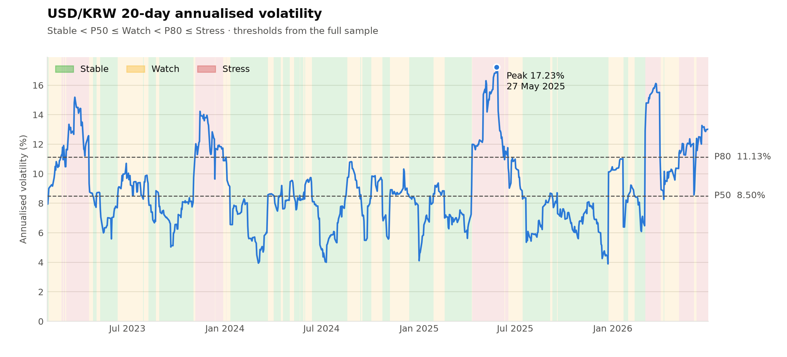
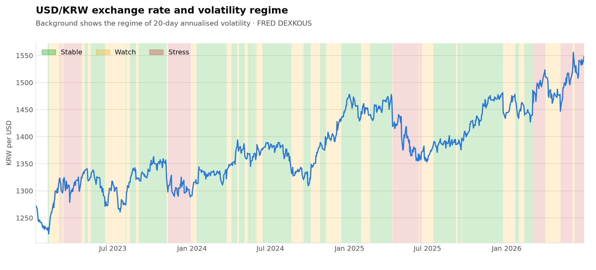

# USD/KRW Volatility Regime Analysis

A Python replication of an Excel-based FX volatility signal. Daily USD/KRW rates are turned into
20-day rolling annualised volatility, and each day is classified as **Stable**, **Watch** or **Stress**.
Every step is checked against the original Excel model, and all checks pass.

`Python` · `pandas` · `NumPy` · `Matplotlib` · `pytest` · Data: FRED `DEXKOUS`



## Key results (Jan 2023 – Jun 2026)

| | |
|---|---|
| Trading days / volatility observations | 911 / 891 |
| Stable / Watch / Stress days | 445 (49.9%) / 267 (30.0%) / 179 (20.1%) |
| Regime switches | 67 |
| Peak annualised volatility | 17.23% on 27 May 2025 |
| Longest Stress episode | 43 days (11 Apr – 10 Jun 2025) |

**Regimes are persistent.** Once volatility enters Stable or Stress, it stays there the next day about 94–95% of
the time. Watch is the least stable state (88%), working as a transition zone. In the whole sample, volatility
moved straight from Stable to Stress only once.

| Today → Tomorrow | Stable | Watch | Stress |
|---|---|---|---|
| **Stable** | 94.6% | 5.2% | 0.2% |
| **Watch** | 8.6% | 87.6% | 3.7% |
| **Stress** | 0.0% | 5.6% | 94.4% |

| Regime | Episodes | Average length (days) | Longest (days) |
|---|---|---|---|
| Stable | 24 | 18.5 | 68 |
| Watch | 33 | 8.1 | 34 |
| Stress | 11 | 16.3 | 43 |

There were four main stress clusters: Mar–Apr 2023, Nov–Dec 2023, Apr–Jun 2025 (the sample peak), and
Mar–Jun 2026.



## Methodology

**1. Data.** FRED series `DEXKOUS` (won per US dollar, daily). The data has 37 missing quotes, mostly on US market
holidays. Each one is forward-filled with the previous rate, so the return on those days is zero.
This is the same treatment as in the Excel model.

**2. Volatility.**

$$r_t = \ln\left(\frac{P_t}{P_{t-1}}\right) \qquad \sigma_{20,t} = \text{StdDev}(r_{t-19}, \dots, r_t) \times \sqrt{252}$$

The sample standard deviation (`ddof=1`) matches Excel's `STDEV.S`.

**3. Regime classification.** The thresholds are the 50th and 80th percentiles of all 891 volatility observations.

| Regime | Rule | Threshold |
|---|---|---|
| Stable | σ < P50 | P50 = 8.5024% |
| Watch | P50 ≤ σ < P80 | |
| Stress | σ ≥ P80 | P80 = 11.1277% |

The percentile split was chosen to give a balanced three-state signal. Half of all days count as normal
conditions, and the top fifth of volatility is flagged as stress.

## Validation against Excel

`src/validation.py` reads the exported Excel model (`data/excel_output/FX_Volatility.csv`) and compares the two
results row by row:

| Check | Result |
|---|---|
| Log returns, rolling σ, annualised σ (max abs. difference) | ≤ 5 × 10⁻¹⁰ (Excel rounding) |
| P50 / P80 thresholds | identical to 9 d.p. |
| Regime label on each of 891 days | 0 mismatches |
| Stable / Watch / Stress day counts | 445 / 267 / 179 ✔ |
| Regime switches | 67 ✔ |
| Peak volatility date | 27 May 2025 ✔ |

The same checks run automatically as unit tests (`pytest`).

## Limitations

- **Look-ahead bias.** The P50/P80 thresholds use the full 2023–2026 sample. This is fine for describing past
  regimes, but on any given day an investor would not have known these thresholds. A real-time signal would need
  thresholds estimated only from past data.
- **Window choice.** A 20-day window reacts quickly but is noisy. It produces some one-day regime flips, for
  example around 3 Mar 2023 and 3 Jan 2024.
- **Holiday filling.** Zero returns on forward-filled days slightly lower measured volatility.

## Next steps

- [ ] Expanding-window and rolling-window thresholds (no look-ahead), compared with the full-sample labels
- [ ] Sensitivity to window length (10 / 20 / 60 days) and percentile cut-offs
- [ ] Link regimes to portfolio rebalancing rules

## How to run

```bash
pip install -r requirements.txt
python main.py      # runs the pipeline, prints results, saves outputs/ and figures/
pytest              # replication tests
```

## Project structure

```
usdkrw-volatility-regime-analysis/
├── main.py                  # runs the full pipeline
├── src/
│   ├── config.py            # paths, window, percentiles, colours
│   ├── data_loader.py       # step 1: load FRED data, forward-fill gaps
│   ├── volatility.py        # step 2: log returns, rolling volatility
│   ├── regimes.py           # step 3: thresholds, labels, switches, episodes
│   ├── validation.py        # step 4: comparison with the Excel model
│   └── plots.py             # charts
├── tests/test_replication.py
├── data/
│   ├── raw/DEXKOUS.xlsx               # FRED download
│   └── excel_output/FX_Volatility.csv # original Excel model export
├── outputs/                 # generated tables
└── figures/                 # generated charts
```

*Data source: Board of Governors of the Federal Reserve System (US), South Korean Won to U.S. Dollar Spot
Exchange Rate [DEXKOUS], retrieved from FRED, Federal Reserve Bank of St. Louis.*

*Author: Nia Lee. Python implementation developed with AI assistance; regime design and validation by the author*